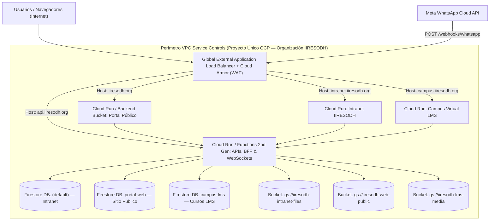

# Plan Arquitectónico y de Migración: Unificación de Sitios Web IIRESODH en un Único Proyecto GCP con VPC Service Controls (VPC-SC) y Cloud Load Balancing

**Documento de Ingeniería de Infraestructura — IIRESODH**  
**Estado:** Planificado (Pendiente de ejecución)  
**Alcance:** Consolidación de múltiples sitios web y portales institucionales (`iiresodh.org`, `intranet.iiresodh.org`, `campus.iiresodh.org`, APIs y Webhooks) en un solo proyecto de Google Cloud Platform (GCP), protegidos bajo un perímetro de **VPC Service Controls (VPC-SC)** y servidos a través de un **Global External Application Load Balancer**.

---

## 1. Resumen Ejecutivo

Actualmente, los distintos sistemas de IIRESODH operan en proyectos independientes de Firebase/GCP (por ejemplo, `litigio-management` para la Intranet, `iiresodh-web` para el portal público `iiresodh.org`, e `iiresodh-cursos-lms` para el Campus Virtual).

Este plan detalla la arquitectura y la hoja de ruta paso a paso para **unificar todos los sitios y sus servicios backend dentro de un único Proyecto de GCP** perteneciente a la Organización de Google Cloud de la institución, cumpliendo simultáneamente con:
1. **Aislamiento lógico de datos** (bases de datos Firestore independientes con nombre y buckets de Cloud Storage separados dentro del mismo proyecto).
2. **Punto de entrada único global** mediante **Cloud Load Balancing (Global External Application Load Balancer)** con IP Anycast fija, certificados SSL gestionados por Google, enrutamiento por dominio (*Host Rules*) y protección WAF con **Google Cloud Armor**.
3. **Blindaje anti-exfiltración con VPC Service Controls (VPC-SC)**, garantizando que las bases de datos (`Firestore`), archivos (`Cloud Storage`), secretos (`Secret Manager`), inteligencia artificial (`Vertex AI`) y microservicios (`Cloud Run`) operen dentro de un perímetro de seguridad a nivel de Organización.
4. **Eliminación de la dependencia de Firebase Realtime Database (`rtdb`)** para lograr compatibilidad del **100% con VPC-SC**, manteniendo detección de presencia y escritura en **tiempo real**.

---

## 2. Arquitectura Objetivo



---

## 3. Decisiones Técnicas Clave

### 3.1. Reemplazo de Firebase Hosting Clásico por Cloud Load Balancing
- *Firebase Hosting clásico* (`*.web.app`) no puede colocarse detrás de un Cloud Load Balancer de GCP ni forma parte de un perímetro VPC-SC.
- **Solución:** Cada sitio compilado (`dist/`) se empaqueta en un servicio ligero de **Cloud Run** (con `ingress: internal-and-cloud-load-balancing`) o en un **Backend Bucket de Cloud Storage con Cloud CDN**, conectado a un único **Global External Application Load Balancer** mediante un **URL Map** que enruta por subdominio (`iiresodh.org`, `intranet.iiresodh.org`, `campus.iiresodh.org`, `api.iiresodh.org`).

### 3.2. Separación de Datos en un Solo Proyecto GCP
- **Cloud Firestore Multi-Database:** Dentro del mismo proyecto de GCP se crean bases de datos Firestore independientes:
  - `(default)`: Intranet IIRESODH (casos, litigios, workspace, WhatsApp, recursos institucionales).
  - `portal-web`: Contenidos públicos editoriales de `iiresodh.org` (noticias, libros, artículos, informes, equipo, cursos).
  - `campus-lms`: Datos académicos del Campus Virtual.
- **Cloud Storage Multi-Bucket:** Un bucket dedicado por cada sistema dentro del mismo proyecto, con sus respectivas reglas de acceso y permisos IAM.
- **Identity Platform (Firebase Auth con Multi-Tenancy):**
  - El personal interno (`@iiresodh.org`) disfruta de **Single Sign-On (SSO)** automático entre la Intranet y el panel de administración del Sitio Web sin necesidad de doble inicio de sesión.
  - Para usuarios externos (por ejemplo, estudiantes del Campus LMS), se habilita **Multi-tenancy** en Identity Platform para mantener su padrón de cuentas 100% aislado del directorio interno.

### 3.3. Compatibilidad con VPC Service Controls (VPC-SC)
- **¿Cómo afecta VPC-SC a las llamadas desde el navegador?**
  - VPC-SC bloquea las llamadas directas desde Internet abierto a `firestore.googleapis.com` y `storage.googleapis.com` si no cumplen una política de ingreso (*Ingress Policy*).
- **Solución en dos frentes:**
  1. **Portal Público (`iiresodh.org`):** Los visitantes anónimos en Internet no consultan Firestore directamente desde el navegador; las lecturas públicas pasan por un endpoint de **Cloud Run (BFF / API)** situado **dentro del perímetro VPC-SC** y acelerado con **Cloud CDN** en el Load Balancer.
  2. **Intranet (`intranet.iiresodh.org`):** Se configura una **Ingress Policy en Access Context Manager (ACM)** que autoriza a las identidades corporativas autenticadas (`@iiresodh.org`) y a la cuenta de servicio de Cloud Run dentro del perímetro.

### 3.4. Resolución de Firebase Realtime Database (`rtdb`) en Tiempo Real Puro
- En el código actual de la Intranet, Realtime Database (`rtdb`) solo se utiliza en dos archivos (`src/components/workspace/EspacioTrabajoSlack.jsx` y `src/components/Layout.jsx`) para **3 datos efímeros**:
  1. Presencia en línea (`presencia/{userKey}/enLinea`).
  2. Estado de disponibilidad y estado personalizado (`estadoId`, `estadoEmoji`, `estadoTexto`, `lecturasCanales`).
  3. Aviso efímero `"Está escribiendo..."` (`typing/{canalId}/{userKey}`).
- Dado que Realtime Database **no es compatible con VPC-SC**, se migra al 100% a **Cloud Firestore + WebSocket en Cloud Run**:
  - **Cambios en vivo (~100 ms):** `onSnapshot` de Firestore notifica instantáneamente al entrar, cambiar de estado, escribir en un canal o cerrar sesión/pestaña (`pagehide` / `visibilitychange`).
  - **Detección instantánea de caídas abruptas de red/energía (`onDisconnect`):** Un canal **WebSocket nativo en Cloud Run** (`/ws/presencia`), ubicado detrás del Load Balancer y dentro del perímetro VPC-SC, detecta en milisegundos el cierre abrupto del socket TCP (`socket.on('close')`) y actualiza `enLinea: false` en Firestore inmediatamente, con un *heartbeat* de respaldo.

---

## 4. Requisitos Previos (Checklist del Administrador antes de Iniciar)

Antes de ejecutar la automatización, se requiere contar con estos **5 puntos**:

- [ ] **1. Autenticación en `gcloud` CLI con la cuenta Superadmin de la Organización:**
  ```powershell
  gcloud auth login webmaster@iiresodh.org
  gcloud config set account webmaster@iiresodh.org
  ```
- [ ] **2. Permisos IAM a nivel de Organización (`Google Cloud Organization`):**
  La cuenta administradora debe contar con los roles:
  - `roles/resourcemanager.organizationAdmin` (Organization Administrator)
  - `roles/resourcemanager.projectCreator` (Project Creator)
  - `roles/billing.user` (Billing Account User)
  - `roles/accesscontextmanager.policyAdmin` (Access Context Manager Admin — requerido para VPC-SC)
  - `roles/compute.networkAdmin` y `roles/compute.securityAdmin` (para Load Balancer y Cloud Armor)
- [ ] **3. Rutas locales o repositorios Git de todos los sitios a unificar:**
  - `iiresodh-intranet` (actual)
  - `iiresodh-web` (portal público `iiresodh.org`)
  - `iiresodh-cursos-lms` (Campus Virtual)
  - Cualquier otro micrositio institucional adicional.
- [ ] **4. Acceso a la consola de Google Cloud (APIs & Services > Credentials):**
  Para agregar las URLs definitivas en los *Authorized JavaScript Origins* y *Authorized Redirect URIs* del cliente OAuth 2.0.
- [ ] **5. Acceso al panel DNS del dominio `iiresodh.org` y a Meta for Developers:**
  Para apuntar los registros `A` a la IP Anycast del Load Balancer una vez validada toda la infraestructura (migración *Zero-Downtime*) y actualizar la URL del webhook de WhatsApp.

---

## 5. Fases de Ejecución Automatizada (Paso a Paso)

### Fase 1: Aprovisionamiento del Proyecto Único y Red Base
1. Crear el proyecto unificado (ej. `iiresodh-cloud-core`) dentro del nodo de Organización de GCP y vincular la cuenta de facturación.
2. Habilitar las APIs necesarias:
   - `compute.googleapis.com`, `run.googleapis.com`, `cloudfunctions.googleapis.com`, `cloudbuild.googleapis.com`, `artifactregistry.googleapis.com`
   - `firestore.googleapis.com`, `storage.googleapis.com`, `identitytoolkit.googleapis.com`
   - `secretmanager.googleapis.com`, `aiplatform.googleapis.com`
   - `accesscontextmanager.googleapis.com`, `vpcaccess.googleapis.com`
3. Crear la red VPC institucional (`vpc-iiresodh-core`) con *Private Google Access* habilitado en las subredes para tráfico interno hacia APIs de Google (`restricted.googleapis.com`).

### Fase 2: Creación y Migración de Bases de Datos y Cloud Storage
1. Crear las bases de datos Firestore dentro del nuevo proyecto:
   - `(default)` (Intranet)
   - `portal-web` (Sitio Web Público)
   - `campus-lms` (Campus Virtual)
2. Crear los buckets de Cloud Storage por entorno/sitio y desplegar sus reglas de seguridad.
3. Ejecutar exportación e importación completa (`gcloud firestore export` / `import` y `gcloud storage rsync`) desde `litigio-management`, `iiresodh-web` e `iiresodh-cursos-lms` hacia el proyecto unificado.
4. Migrar los secretos (`GEMINI_API_KEY`, tokens de Meta WhatsApp, credenciales SMTP) a **Secret Manager** en el nuevo proyecto.

### Fase 3: Refactorización de Presencia (Eliminación de Realtime Database) y Unificación de SDKs
1. Actualizar `src/components/workspace/EspacioTrabajoSlack.jsx` y `src/components/Layout.jsx` para usar la colección `workspace_presencia` en Firestore + WebSocket en Cloud Run, retirando `firebase/database` (`rtdb`).
2. Actualizar `src/config/firebase.js` y `src/config/firebaseWeb.js` para apuntar al proyecto único, utilizando `getFirestore(app, 'portal-web')` para la base de datos secundaria del portal web (aprovechando la misma sesión de autenticación de Firebase Auth).

### Fase 4: Despliegue en Cloud Run y Configuración del Global Load Balancer
1. Contenerizar y desplegar cada aplicación web y los microservicios (`whatsapp_webhook`, `api-portal-web`, funciones de correo y PIDA AI) en **Cloud Run** con restricción de ingreso `internal-and-cloud-load-balancing`.
2. Reservar una **IPv4 estática global** (`ip-iiresodh-global-lb`).
3. Crear los **Serverless Network Endpoint Groups (Serverless NEGs)**, **Backend Services**, el **URL Map** con reglas por host (`iiresodh.org`, `intranet.iiresodh.org`, `campus.iiresodh.org`, `api.iiresodh.org`), el certificado SSL gestionado (`Managed SSL Certificate`) y la política WAF de **Cloud Armor**.

### Fase 5: Configuración de VPC Service Controls (VPC-SC)
1. Crear la política de acceso en **Access Context Manager (ACM)** y definir los niveles de acceso (*Access Levels*) para identidades institucionales `@iiresodh.org` y cuentas de servicio internas.
2. Configurar el perímetro **VPC-SC** en **Modo de Prueba (*Dry-Run Mode*)** incluyendo:
   - `firestore.googleapis.com`
   - `storage.googleapis.com`
   - `run.googleapis.com`
   - `secretmanager.googleapis.com`
   - `aiplatform.googleapis.com`
3. Configurar las reglas de *Ingress* (para usuarios autorizados y el webhook de Meta a través del Load Balancer) y *Egress* (para llamadas salientes a `graph.facebook.com` de WhatsApp y Google Workspace APIs).
4. Auditar los registros de *Dry-Run* en Cloud Logging para confirmar cero bloqueos falsos positivos y activar el perímetro en **Modo Enforced (Activo)**.

### Fase 6: Cutover DNS Sin Tiempo de Inactividad (Zero-Downtime)
1. Validar cada portal a través del balanceador de carga.
2. Actualizar los registros `A` en el DNS de `iiresodh.org` hacia la IP global del Load Balancer.
3. Actualizar la URL del webhook de WhatsApp en el panel de Meta for Developers.
4. Mantener los proyectos antiguos en modo solo lectura de respaldo durante el periodo de estabilización antes de su retiro definitivo.
