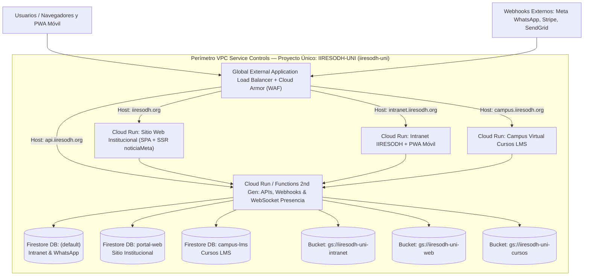

# Plan Maestro y Bitácora de Ejecución Paso a Paso: Unificación en `IIRESODH-UNI` bajo VPC Service Controls (VPC-SC) y Global Load Balancing

**Documento Oficial de Ingeniería de Infraestructura — IIRESODH**  
**Proyecto Destino en GCP / Firebase:** Nombre visible `IIRESODH-UNI` | Project ID: `iiresodh-uni`  
**Estado General:** 🟡 Fase 0 (Pre-vuelo completado — Listo para iniciar Paso 1)  
**Última actualización:** 31 de octubre de 2026

---

## 1. Resumen Ejecutivo y Garantía de Infraestructura Paralela (Zero-Downtime)

Este documento constituye el **plan operativo numerado y la bitácora oficial de registro** para trasladar y unificar los **3 sistemas principales de IIRESODH** dentro de un único proyecto corporativo de Google Cloud Platform (`IIRESODH-UNI` / `iiresodh-uni`), blindado bajo un perímetro de **VPC Service Controls (VPC-SC)** y servido mediante un único **Global External Application Load Balancer** con **Google Cloud Armor (WAF)**.

### 🛡️ Garantía de Estructura Paralela (Cero Interrupción durante la Implementación)
1. **Nada de lo actual se apaga ni se modifica en producción mientras construimos:** Los tres proyectos actuales (`litigio-management`, `iiresodh-web` e `iiresodh-cursos-lms`) seguirán operando con normalidad y atendiendo a los usuarios en sus dominios actuales durante toda la construcción.
2. **Entorno paralelo completo en `iiresodh-uni`:** Crearemos el proyecto `iiresodh-uni`, sus bases de datos Firestore aisladas, sus buckets de Cloud Storage, sus servicios de Cloud Run, el Load Balancer Global y el perímetro VPC-SC de manera **100% paralela**.
3. **Pruebas integrales previas al cambio de DNS:** Antes de tocar un solo registro DNS de `iiresodh.org`, probaremos la Intranet (incluyendo la nueva PWA Móvil), el Sitio Web Institucional y el Campus de Cursos directamente contra la nueva infraestructura en `iiresodh-uni`.
4. **Cambio de DNS (*Cutover*) solo al final:** Únicamente cuando demos el visto bueno a todas las pruebas en el entorno paralelo, apuntaremos los registros `A` del DNS hacia la IP Anycast del nuevo Load Balancer. Si en cualquier paso surge un imprevisto, **hacemos una pausa inmediata, lo diagnosticamos, lo resolvemos y documentamos antes de avanzar al siguiente punto**.

---

## 2. Inventario Auditado de los 3 Sistemas a Unificar (Pre-Flight Check)

La auditoría técnica de los repositorios locales arrojó el siguiente inventario exacto que será trasladado a `iiresodh-uni`:

| # | Sistema | Ruta Local Exacta del Proyecto | Proyecto Actual (`Project ID` / `Number`) | Base de Datos Firestore en `iiresodh-uni` | Bucket Cloud Storage en `iiresodh-uni` | Cloud Functions / Microservicios Detectados |
| :--- | :--- | :--- | :--- | :--- | :--- | :--- |
| **1** | **Intranet IIRESODH + PWA Móvil** | `C:\Users\durquilla\Documentos\PROYECTOS DESARROLLO\iiresodh-intranet` | `litigio-management` (`684823202496`) | `(default)` | `gs://iiresodh-uni-intranet` | **Node.js (`functions/`):** `webhookSendGrid`, `crearEventoCalendario`, `obtenerEventosCalendario`, `eliminarEventoCalendario`, `actualizarEventoCalendario`, `enviarComunicadoInstitucional`, `confirmarLecturaComunicado`, `consultarVertexLitigioIA`<br>**Python 3.12 (`whatsapp/`):** `whatsapp_webhook`, `notificar_workspace` |
| **2** | **Sitio Web Institucional (`iiresodh.org`)** | `C:\Users\durquilla\Documentos\PROYECTOS DESARROLLO\IIRESODH-WEB\iiresodh-web` *(Nota: el código fuente está dentro de la subcarpeta `iiresodh-web`)* | `iiresodh-web` (`943078828913`) | `portal-web` | `gs://iiresodh-uni-web` | **Node.js (`functions/`):** `generarResumenGemini`, `noticiaMeta` (SSR OpenGraph), `enviarFormularioContacto`, `chatPidaStream` (Chatbot IRENE), `validarCuponStripe` (con lectura cruzada a PIDA), `crearIntentoPago`, `stripeWebhook` (Social DRM PDF), `traductorAutomatico`, `descargarDocumento`, `crearIntentoPagoCurso`, `stripeWebhookCursos`, `procesarCobrosYRecordatoriosCuotasCursos` (Cron), `reenviarConfirmacionCurso`, `generarEnlacePagoCurso`, `validarCuponDescuento`, `crearCuponCursoStripe`, `toggleEstadoCuponCursoStripe`, `eliminarCuponCursoStripe`, `sincronizarComisionesStripeCursos`, `consultarEstadoMercuryCursos` |
| **3** | **Campus Virtual de Cursos (LMS)** | `C:\Users\durquilla\Documentos\ANTIGRAVITY\CURSOS-LMS` | `iiresodh-cursos-lms` (`761983185419`) | `campus-lms` | `gs://iiresodh-uni-cursos` | **TypeScript/Node.js (`functions/src/`):** `streamTutorResponse`, `gradeOpenAnswer`, `generateStudyAids`, `generateCourseQuiz`, `generateRemediationGuide`, `sendInstitutionalEmail`, `processInstitutionalMailQueue`, `generateCourseFromDocument` |

---

## 3. ¿Podemos Agregar Más Sitios y Sistemas en el Futuro bajo VPC-SC?

**Sí, 100% confirmado.** La arquitectura en `iiresodh-uni` queda diseñada como un **Hub Institucional Escalable**. Cuando en el futuro deseemos incorporar otros sistemas (por ejemplo, `agoracr`, `observatorio-laboral-cr`, `sigel-colombia`, `sipdh-intranet` o cualquier portal nuevo), **no habrá que crear otro Load Balancer ni otro perímetro VPC-SC**. El procedimiento para sumar un sistema adicional tomará solo minutos:
1. Crear una nueva base de datos Firestore con nombre dentro de `iiresodh-uni` (ej. `observatorio-cr`) y su bucket dedicado (`gs://iiresodh-uni-observatorio`). Al nacer dentro del proyecto `iiresodh-uni`, **queda automáticamente protegida por el perímetro VPC-SC**.
2. Desplegar el frontend/API del nuevo sitio en un nuevo servicio de **Cloud Run** dentro de `iiresodh-uni` con `--ingress internal-and-cloud-load-balancing`.
3. Añadir una sola regla de subdominio (*Host Rule*, ej. `observatorio.iiresodh.org`) al **URL Map del mismo Global Load Balancer** y actualizar el certificado SSL.

---

## 4. Arquitectura Objetivo en `IIRESODH-UNI` (`iiresodh-uni`)



---

## 5. Diagnóstico Pre-Vuelo Actual y Puntos Detectados Antes de Empezar

Antes de ejecutar el **Paso 1**, revisamos el estado de las herramientas y encontramos lo siguiente:

1. ✅ **Firebase CLI (`npx firebase-tools`)**: Ya está autenticado correctamente con `webmaster@iiresodh.org` y tiene visibilidad sobre los 3 proyectos origen (`litigio-management`, `iiresodh-web`, `iiresodh-cursos-lms`).
2. ⚠️ **Google Cloud SDK (`gcloud` CLI)**: Aunque la cuenta `webmaster@iiresodh.org` aparece registrada en `gcloud auth list`, su token OAuth en `gcloud` expiró (`Reauthentication failed`) y la cuenta activa de `gcloud` es `webmaster@pida-ai.com`. **Se resuelve en el Paso 1** autenticando `gcloud` con `webmaster@iiresodh.org`.
3. ✅ **Archivos con Realtime Database (`rtdb`) en la Intranet**: Como hoy creamos la PWA Móvil (`src/views/PwaComunicacionesMobile.jsx`), además de `src/components/workspace/EspacioTrabajoSlack.jsx` y `src/components/Layout.jsx`, ahora son **3 archivos** los que usan `rtdb` para presencia en línea y aviso *"Escribiendo..."*. Los 3 están contemplados en el **Paso 9** para migrarlos a Firestore en tiempo real + WebSocket en Cloud Run (100% compatible con VPC-SC).
4. ✅ **Secretos y Conexiones Externas Detectadas**:
   - **Sitio Web (`iiresodh-web`)**: Usa secretos en Secret Manager (`GMAIL_CLIENT_ID`, `GMAIL_CLIENT_SECRET`, `GMAIL_REFRESH_TOKEN`, `STRIPE_SECRET_KEY`, `STRIPE_WEBHOOK_SECRET`, `STRIPE_CURSOS_SECRET_KEY`, `STRIPE_CURSOS_WEBHOOK_SECRET`, `PIDA_SERVICE_ACCOUNT`, `MERCURY_API_KEY`, `MERCURY_CURSOS_ACCOUNT_ID`) y se conecta al Firestore de PIDA (`getPidaFirestore`) para validar cupones `PIDA*`.
   - **Intranet (`litigio-management`)**: Usa tokens de Meta WhatsApp Cloud API, credenciales de Google Calendar / SMTP / SendGrid y Vertex AI.
   - **Cursos (`iiresodh-cursos-lms`)**: Usa Vertex AI / Gemini y envío de correo institucional.
   - Todo esto se migrará al Secret Manager de `iiresodh-uni` y tendrá sus reglas de salida (*Egress*) en el perímetro VPC-SC.

---

## 6. Plan de Implementación Paso a Paso (Con Asignación de Responsable y Bitácora)

> [!IMPORTANT]
> **Metodología de Trabajo:**  
> Avanzaremos **estrictamente un paso a la vez** en orden numérico.  
> - En cada paso se indica **`[EJECUTA: USUARIO]`** o **`[EJECUTA: AGENTE]`** (o **`[CONJUNTO]`**).  
> - Cuando sea tu turno, te daré el comando o instrucción exacta y esperaré tu confirmación.  
> - Cuando sea mi turno, ejecutaré la acción, verificaré que no haya errores, actualizaré la tabla de bitácora en este documento y te informaré exactamente qué hice antes de pasar al siguiente punto.

---

### ETAPA 1: Autenticación, Verificación de Organización GCP y Creación del Proyecto `IIRESODH-UNI`

#### **Paso 1 — Autenticación de `gcloud` CLI con `webmaster@iiresodh.org`**
- **Responsable:** `[EJECUTA: USUARIO]`
- **Estado:** ⏳ Pendiente
- **Acción a realizar:** Abrir una terminal en tu equipo y ejecutar:
  ```powershell
  gcloud auth login webmaster@iiresodh.org
  gcloud config set account webmaster@iiresodh.org
  ```
- **Objetivo:** Renovar el token de `gcloud` para la cuenta administradora de `iiresodh.org`.

#### **Paso 2 — Auditoría de Organización GCP, Cuenta de Facturación y Permisos VPC-SC**
- **Responsable:** `[EJECUTA: AGENTE]`
- **Estado:** ⏳ Pendiente
- **Acción a realizar:** Ejecutar comandos de solo lectura en `gcloud` para:
  1. Obtener el `ORGANIZATION_ID` de `iiresodh.org` (`gcloud organizations list`).
  2. Obtener el `BILLING_ACCOUNT_ID` activo (`gcloud billing accounts list`).
  3. Verificar que `webmaster@iiresodh.org` posea los permisos a nivel de Organización para crear el proyecto y configurar Access Context Manager / VPC-SC (`organizationAdmin`, `accesscontextmanager.policyAdmin`, `billing.user`). Si falta algún rol en el nodo de Organización, el agente dará el comando exacto para auto-asignarlo.

#### **Paso 3 — Creación del Proyecto `IIRESODH-UNI` (`iiresodh-uni`) y Vinculación de Facturación + Firebase**
- **Responsable:** `[EJECUTA: AGENTE]`
- **Estado:** ⏳ Pendiente
- **Acción a realizar:**
  1. Crear el proyecto en GCP dentro de la Organización de `iiresodh.org`:
     - **Nombre visible:** `IIRESODH-UNI`
     - **Project ID:** `iiresodh-uni` (o `iiresodh-uni-core` si el ID global estuviese tomado, previa confirmación).
  2. Vincular la cuenta de facturación institucional (Plan Blaze requerido para Cloud Run, Cloud Build y múltiples bases de datos).
  3. Agregar los recursos de Firebase al proyecto (`firebase projects:addfirebase iiresodh-uni`) y crear las Web Apps registradas en Firebase para obtener las credenciales SDK (`apiKey`, `appId`) del nuevo proyecto unificado.

#### **Paso 4 — Habilitación de APIs en `iiresodh-uni` y Creación de la Red VPC Institucional**
- **Responsable:** `[EJECUTA: AGENTE]`
- **Estado:** ⏳ Pendiente
- **Acción a realizar:**
  1. Habilitar en `iiresodh-uni` todas las APIs necesarias: `compute.googleapis.com`, `run.googleapis.com`, `cloudfunctions.googleapis.com`, `cloudbuild.googleapis.com`, `artifactregistry.googleapis.com`, `firestore.googleapis.com`, `storage.googleapis.com`, `identitytoolkit.googleapis.com`, `fcm.googleapis.com`, `secretmanager.googleapis.com`, `aiplatform.googleapis.com`, `cloudscheduler.googleapis.com`, `accesscontextmanager.googleapis.com`, `vpcaccess.googleapis.com`.
  2. Crear la red VPC `vpc-iiresodh-uni` y su subred en `us-central1` con **Private Google Access** activado (necesario para que el tráfico interno hacia APIs de Google viaje de forma privada dentro del perímetro VPC-SC).

---

### ETAPA 2: Creación de Bases de Datos Aisladas, Buckets, Secretos y Copia de Datos en Paralelo

#### **Paso 5 — Creación de las 3 Bases de Datos Firestore y los 3 Buckets de Cloud Storage**
- **Responsable:** `[EJECUTA: AGENTE]`
- **Estado:** ⏳ Pendiente
- **Acción a realizar:**
  1. Crear en `iiresodh-uni` (región `nam5` / `us-central1`) las 3 bases de datos Firestore nativas independientes:
     - `(default)` $\rightarrow$ Intranet IIRESODH + WhatsApp + Workspace.
     - `portal-web` $\rightarrow$ Sitio Web Institucional (`iiresodh.org`).
     - `campus-lms` $\rightarrow$ Campus Virtual de Cursos (`CURSOS-LMS`).
  2. Crear en `iiresodh-uni` los 3 buckets independientes de Cloud Storage:
     - `gs://iiresodh-uni-intranet` (además del bucket default de Firebase Storage)
     - `gs://iiresodh-uni-web`
     - `gs://iiresodh-uni-cursos`
  3. Desplegar los índices compuestos (`firestore.indexes.json`) y las reglas de seguridad (`firestore.rules` y `storage.rules`) correspondientes a cada base de datos y bucket.

#### **Paso 6 — Clonación (Export / Import) de Firestore, Cloud Storage y Usuarios de Auth hacia `iiresodh-uni`**
- **Responsable:** `[EJECUTA: AGENTE]`
- **Estado:** ⏳ Pendiente
- **Acción a realizar:**
  1. Exportar los datos actuales de Firestore de `litigio-management`, `iiresodh-web` e `iiresodh-cursos-lms` a un bucket puente temporal y realizar `gcloud firestore import` hacia `(default)`, `portal-web` y `campus-lms` en `iiresodh-uni` (los proyectos originales no sufren ninguna alteración).
  2. Sincronizar todos los archivos de Cloud Storage (`gcloud storage rsync -r`) desde los 3 proyectos originales hacia los nuevos buckets en `iiresodh-uni`.
  3. Configurar **Identity Platform / Firebase Auth** en `iiresodh-uni` y migrar las cuentas de usuarios existentes (`firebase auth:export` / `auth:import`), habilitando un *Tenant* aislado si se desea separar el padrón de estudiantes externos del directorio interno `@iiresodh.org`.

#### **Paso 7 — Migración de Secretos a Secret Manager en `iiresodh-uni`**
- **Responsable:** `[CONJUNTO: AGENTE + USUARIO]`
- **Estado:** ⏳ Pendiente
- **Acción a realizar:**
  1. **`[AGENTE]`**: Copiar automáticamente todos los secretos existentes en Secret Manager de `litigio-management`, `iiresodh-web` e `iiresodh-cursos-lms` (`GMAIL_CLIENT_ID`, `GMAIL_CLIENT_SECRET`, `GMAIL_REFRESH_TOKEN`, `STRIPE_SECRET_KEY`, `STRIPE_WEBHOOK_SECRET`, `STRIPE_CURSOS_SECRET_KEY`, `STRIPE_CURSOS_WEBHOOK_SECRET`, `PIDA_SERVICE_ACCOUNT`, `MERCURY_API_KEY`, `MERCURY_CURSOS_ACCOUNT_ID`, tokens de WhatsApp, etc.) hacia el Secret Manager de `iiresodh-uni`, y otorgar permisos IAM (`secretAccessor`) a la cuenta de servicio de `iiresodh-uni`.
  2. **`[USUARIO]`**: Únicamente si algún secreto antiguo estuviera en variables locales no accesibles por `gcloud secrets`, confirmarlo o proporcionarlo cuando el agente lo indique.

#### **Paso 8 — Configuración de Proveedores de Inicio de Sesión (Google Sign-In / OAuth) en `iiresodh-uni`**
- **Responsable:** `[CONJUNTO: AGENTE + USUARIO]`
- **Estado:** ⏳ Pendiente
- **Acción a realizar:**
  1. **`[AGENTE]`**: Habilitar Email/Password, Anonymous (usado por catálogo de cursos) y Google Sign-In mediante la API de Identity Platform en `iiresodh-uni`.
  2. **`[USUARIO]`**: En la consola de Google Cloud de `IIRESODH-UNI` (`APIs & Services > Credentials`), verificar que en el *OAuth 2.0 Client ID* web estén agregados los dominios autorizados (`iiresodh.org`, `intranet.iiresodh.org`, `campus.iiresodh.org` y las URLs de prueba del Load Balancer). El agente te dará la lista exacta para copiar y pegar.

---

### ETAPA 3: Adaptación de los 3 Repositorios para `IIRESODH-UNI` y Compatibilidad 100% VPC-SC

#### **Paso 9 — Reemplazo de Realtime Database (`rtdb`) por Firestore en Tiempo Real + WebSocket en la Intranet y PWA Móvil**
- **Responsable:** `[EJECUTA: AGENTE]`
- **Estado:** ⏳ Pendiente
- **Acción a realizar:**
  1. Crear el microservicio ligero de presencia WebSocket (`/ws/presencia`) para detectar desconexiones abruptas (`socket.on('close')`) y marcar `enLinea: false` en Firestore de inmediato.
  2. Actualizar los 3 archivos de `iiresodh-intranet` que usan `rtdb`:
     - `src/components/workspace/EspacioTrabajoSlack.jsx`
     - `src/components/Layout.jsx`
     - `src/views/PwaComunicacionesMobile.jsx`
     para que consuman presencia, estados personalizados y el indicador *"Escribiendo..."* desde Firestore (`workspace_presencia` y `workspace_typing`) + el WebSocket, eliminando la dependencia de `firebase/database` (`rtdb`) para lograr compatibilidad del 100% con VPC-SC.

#### **Paso 10 — Actualización de Configuración en los 3 Repositorios (`.firebaserc`, SDKs y `functions`)**
- **Responsable:** `[EJECUTA: AGENTE]`
- **Estado:** ⏳ Pendiente
- **Acción a realizar:**
  1. En **`iiresodh-intranet`**:
     - Apuntar `src/config/firebase.js` al proyecto `iiresodh-uni` (base de datos `(default)` y bucket `gs://iiresodh-uni-intranet`).
     - Apuntar `src/config/firebaseWeb.js` (el módulo CMS de Administración del Sitio Web integrado en la Intranet) a la base de datos `portal-web` (`getFirestore(app, 'portal-web')`) y al bucket `gs://iiresodh-uni-web` dentro del **mismo proyecto `iiresodh-uni`**, logrando **Single Sign-On (SSO) nativo** con la misma sesión de `@iiresodh.org`.
  2. En **`IIRESODH-WEB/iiresodh-web`**:
     - Apuntar `src/firebase/config.js` y `functions/index.js` al proyecto `iiresodh-uni`, base de datos `portal-web` (`getFirestore(app, 'portal-web')`) y bucket `gs://iiresodh-uni-web`.
  3. En **`CURSOS-LMS`**:
     - Apuntar `src/firebase.js` y `functions/src/index.ts` al proyecto `iiresodh-uni`, base de datos `campus-lms` (`getFirestore(app, 'campus-lms')`) y bucket `gs://iiresodh-uni-cursos`.

---

### ETAPA 4: Despliegue en Cloud Run y Configuración del Global Load Balancer + Cloud Armor

#### **Paso 11 — Despliegue de Microservicios Backend y Cloud Functions 2nd Gen en `iiresodh-uni`**
- **Responsable:** `[EJECUTA: AGENTE]`
- **Estado:** ⏳ Pendiente
- **Acción a realizar:**
  1. Desplegar los grupos de funciones (*codebases*) en `iiresodh-uni`:
     - Codebase `intranet-node` (funciones de `iiresodh-intranet/functions`)
     - Codebase `intranet-whatsapp` (`whatsapp_webhook` y `notificar_workspace` en Python 3.12)
     - Codebase `portal-web` (funciones de `IIRESODH-WEB/iiresodh-web/functions`, incluyendo `noticiaMeta`, `chatPidaStream`, `stripeWebhook`, etc.)
     - Codebase `campus-lms` (funciones de `CURSOS-LMS/functions`)
  2. Configurar el control de ingreso (`--ingress internal-and-cloud-load-balancing`) en los servicios expuestos a través del balanceador.

#### **Paso 12 — Contenerización y Despliegue de los 3 Frontends en Cloud Run (`iiresodh-uni`)**
- **Responsable:** `[EJECUTA: AGENTE]`
- **Estado:** ⏳ Pendiente
- **Acción a realizar:**
  1. Compilar (`npm run build`) y empaquetar cada uno de los 3 sitios en contenedores Nginx/Node ultraligeros en Cloud Run dentro de `iiresodh-uni`:
     - Servicio `cr-iiresodh-web`: sirve el Portal Institucional (`iiresodh.org`) con las redirecciones 301 y rewrites a `noticiaMeta` y `descargarDocumento`.
     - Servicio `cr-iiresodh-intranet`: sirve la Intranet y la PWA Móvil (`intranet.iiresodh.org`) con los encabezados COOP y Service Worker (`firebase-messaging-sw.js`).
     - Servicio `cr-iiresodh-cursos`: sirve el Campus Virtual LMS (`campus.iiresodh.org`).
  2. Configurar en los 3 servicios `--ingress internal-and-cloud-load-balancing` para que nadie pueda invocarlos saltándose el Load Balancer y Cloud Armor.

#### **Paso 13 — Creación del Global External Application Load Balancer y Cloud Armor (WAF)**
- **Responsable:** `[EJECUTA: AGENTE]`
- **Estado:** ⏳ Pendiente
- **Acción a realizar:**
  1. Reservar la dirección **IPv4 Anycast Global estática** (`ip-iiresodh-uni-lb`).
  2. Crear los **Serverless Network Endpoint Groups (Serverless NEGs)** y **Backend Services** (con Cloud CDN activado para activos estáticos públicos).
  3. Configurar el **URL Map (`lb-iiresodh-uni`)** con enrutamiento por dominio (*Host Rules*):
     - `iiresodh.org` y `www.iiresodh.org` $\rightarrow$ `cr-iiresodh-web`
     - `intranet.iiresodh.org` $\rightarrow$ `cr-iiresodh-intranet`
     - `campus.iiresodh.org` (o el subdominio de cursos que definamos) $\rightarrow$ `cr-iiresodh-cursos`
     - `api.iiresodh.org` $\rightarrow$ Webhooks y APIs (`whatsapp_webhook`, `stripeWebhook`, `webhookSendGrid`, etc.)
  4. Crear el **Certificado SSL Gestionado por Google (`Managed SSL Certificate`)** para todos los dominios y adjuntar la política de seguridad de **Google Cloud Armor**.

---

### ETAPA 5: Configuración y Activación del Perímetro VPC Service Controls (VPC-SC)

#### **Paso 14 — Creación de Política en Access Context Manager (ACM) y Perímetro VPC-SC en Modo Prueba (*Dry-Run*)**
- **Responsable:** `[EJECUTA: AGENTE]`
- **Estado:** ⏳ Pendiente
- **Acción a realizar:**
  1. Crear el *Access Level* institucional en Access Context Manager autorizando a las identidades de `@iiresodh.org` y a las cuentas de servicio de `iiresodh-uni`.
  2. Crear el perímetro **VPC Service Controls (`perimetro_iiresodh_uni`)** inicialmente en **Modo de Prueba (*Dry-Run Mode*)** protegiendo el proyecto `iiresodh-uni` y los servicios:
     - `firestore.googleapis.com`
     - `storage.googleapis.com`
     - `run.googleapis.com`
     - `cloudfunctions.googleapis.com`
     - `secretmanager.googleapis.com`
     - `aiplatform.googleapis.com`
  3. Configurar las reglas de **Ingress** (acceso de aplicaciones cliente autenticadas y entrada por el Load Balancer) y **Egress** (permiso hacia el proyecto PIDA para la validación de cupones `PIDA*` y servicios externos autorizados).

#### **Paso 15 — Pruebas Integrales en Paralelo y Activación del Perímetro VPC-SC (*Enforced Mode*)**
- **Responsable:** `[CONJUNTO: AGENTE + USUARIO]`
- **Estado:** ⏳ Pendiente
- **Acción a realizar:**
  1. **`[AGENTE + USUARIO]`**: Probar en paralelo (sin haber cambiado aún el DNS en producción) los 3 sistemas en `iiresodh-uni`:
     - Sitio Web Institucional (`iiresodh.org` en el nuevo entorno): noticias, libros, chatbot IRENE, formulario de contacto.
     - Intranet + PWA Móvil: login con `@iiresodh.org`, casos de litigio, WhatsApp, Workspace en tiempo real, administración del sitio web desde la Intranet.
     - Campus Virtual LMS: catálogo de cursos, aula virtual, tutor IA.
  2. **`[AGENTE]`**: Auditar los logs de `VPC Service Controls Dry-Run` en Cloud Logging para verificar que haya **0 bloqueos legítimos** y pasar el perímetro VPC-SC a **Modo Activo (*Enforced Mode*)**.

---

### ETAPA 6: Cambio de DNS (*Cutover* Final) y Actualización de Webhooks

#### **Paso 16 — Cambio de Registros DNS y Actualización de Webhooks en Meta / Stripe / SendGrid**
- **Responsable:** `[EJECUTA: USUARIO]` (con acompañamiento en vivo del Agente)
- **Estado:** ⏳ Pendiente
- **Acción a realizar:**
  1. En el panel de DNS de `iiresodh.org`, apuntar los registros `A` de `iiresodh.org`, `www.iiresodh.org`, `intranet.iiresodh.org`, `campus.iiresodh.org` y `api.iiresodh.org` a la IP Anycast Global (`ip-iiresodh-uni-lb`) que te entregará el Agente.
  2. Actualizar la URL del Webhook en **Meta for Developers (WhatsApp)**, **Stripe Dashboard** y **SendGrid** hacia el nuevo dominio en `iiresodh-uni`.
  3. **`[AGENTE]`**: Verificar la activación del certificado SSL (`ACTIVE`), monitorear el tráfico en vivo y confirmar que toda la operación esté 100% estable en `IIRESODH-UNI`. (Los proyectos antiguos quedan intactos como respaldo en frío durante el periodo de gracia que decidas).

---

## 7. Bitácora de Registro de Ejecución

Cada vez que completemos un paso, actualizaremos esta tabla con la fecha/hora exacta, los recursos creados y el resultado:

| Paso | Descripción Corta | Ejecuta | Estado | Fecha / Hora | Notas y Recursos Creados |
| :---: | :--- | :---: | :---: | :---: | :--- |
| **0** | Auditoría Pre-Vuelo de los 3 repositorios y plan paso a paso en `/DOCS` | `AGENTE` | ✅ Completado | 2026-10-31 11:02 | Auditados `iiresodh-intranet` (`litigio-management`), `IIRESODH-WEB/iiresodh-web` (`iiresodh-web`) y `CURSOS-LMS` (`iiresodh-cursos-lms`). |
| **1** | Autenticación de `gcloud` CLI con `webmaster@iiresodh.org` | `USUARIO` | ⏳ Pendiente | — | Esperando ejecución de `gcloud auth login webmaster@iiresodh.org`. |
| **2** | Auditoría de Organización GCP, Facturación y Permisos VPC-SC | `AGENTE` | ⏳ Pendiente | — | — |
| **3** | Creación del proyecto `IIRESODH-UNI` (`iiresodh-uni`) + Billing + Firebase | `AGENTE` | ⏳ Pendiente | — | — |
| **4** | Habilitación de APIs y creación de red VPC `vpc-iiresodh-uni` | `AGENTE` | ⏳ Pendiente | — | — |
| **5** | Creación de 3 bases Firestore (`(default)`, `portal-web`, `campus-lms`) y 3 Buckets | `AGENTE` | ⏳ Pendiente | — | — |
| **6** | Clonación en paralelo de Firestore, Storage y Auth a `iiresodh-uni` | `AGENTE` | ⏳ Pendiente | — | — |
| **7** | Migración de Secretos a Secret Manager en `iiresodh-uni` | `CONJUNTO` | ⏳ Pendiente | — | — |
| **8** | Configuración de Google Sign-In / OAuth en `iiresodh-uni` | `CONJUNTO` | ⏳ Pendiente | — | — |
| **9** | Migración de `rtdb` a Firestore + WebSocket en Intranet y PWA Móvil | `AGENTE` | ⏳ Pendiente | — | — |
| **10** | Conexión de los 3 repositorios a `iiresodh-uni` y SSO | `AGENTE` | ⏳ Pendiente | — | — |
| **11** | Despliegue de Cloud Functions 2nd Gen y Microservicios en `iiresodh-uni` | `AGENTE` | ⏳ Pendiente | — | — |
| **12** | Despliegue de los 3 Frontends en Cloud Run (`iiresodh-uni`) | `AGENTE` | ⏳ Pendiente | — | — |
| **13** | Configuración del Global Load Balancer, URL Map, SSL y Cloud Armor | `AGENTE` | ⏳ Pendiente | — | — |
| **14** | Configuración de Access Context Manager y VPC-SC en modo *Dry-Run* | `AGENTE` | ⏳ Pendiente | — | — |
| **15** | Pruebas integrales en paralelo y activación de VPC-SC en modo *Enforced* | `CONJUNTO` | ⏳ Pendiente | — | — |
| **16** | Cutover DNS final y actualización de URLs de Webhooks | `USUARIO` | ⏳ Pendiente | — | — |
